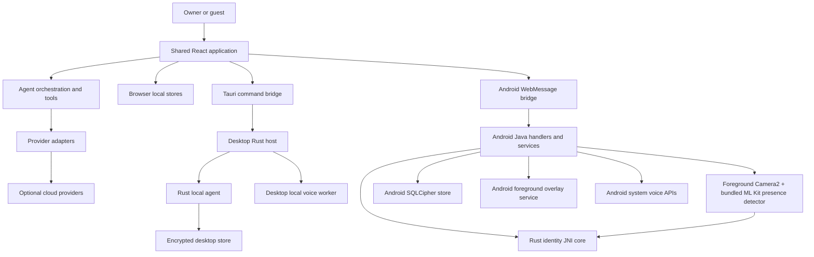

# Miss Minutes system audit

Audit baseline: 2026-11-07, with security/tooling changes recorded through 2026-11-09. Scope follows the owner's single-user, local-first Android and desktop deployment assumption with optional outbound AI providers and no public Miss Minutes server. PSTN telephony remains out of the current runtime and is a separately isolated future integration.

This is a source/build audit, not a claim of device validation or security certification. Build and test evidence is recorded below; the attached Android device list was empty at audit time.

## 1. Repository and runtime shape

| Surface | Runtime / entry points | Main implementation | Persistence / boundary |
|---|---|---|---|
| Shared desktop/browser UI | Vite entry `src/main.tsx`; `src/App.tsx`, `src/OverlayApp.tsx` | React/TypeScript, character renderer, agent orchestration, tools, provider adapters, memory and voice | IndexedDB (`src/store/db.ts`), localStorage settings (`src/agent/settings.ts`), optional WebCrypto remembered secrets (`src/agent/secrets-web.ts`) |
| Android dashboard and overlay | `native/mobile/android/app/src/main/.../MainActivity.java`, `DashboardActivity.java`, `OverlayService.java` | Java/Kotlin-compatible Android framework layer, two WebViews, shared mobile React bundle, typed WebMessage bridge, Java app-world/permission/services | App-private settings, SQLCipher DB and Keystore-wrapped DB key; IndexedDB is retained only as a one-time legacy import source and cleared after successful import |
| Shared native authority | `native/identity` Rust crate and `jni_bridge.rs` | Rust identity/session/policy primitives, challenge verification and guest allowlist; Android Java adapter calls JNI | In-memory Rust registry/session; Android Keystore signing key and app-private owner/device identifiers |
| Local desktop agent | `native/agent` Rust crate | Filesystem metadata collection, SQLCipher evidence store, typed note action queue, optional local reasoner | Local DB encrypted by SQLCipher with OS-vault key; scoped metadata roots and separate note output grants |
| Desktop shell | `native/desktop/src-tauri` | Tauri 2, Rust commands, tray/overlay, Windows process/job control, provider proxy, OAuth, desktop file tools | Tauri IPC, OS credential vault, SQLCipher local store; no public listener in the documented runtime |
| Voice | `native/voice` Python/Pocket TTS/Whisper tooling; TS browser speech and cloud adapters; Android system WebView speech | Desktop has the private local voice worker and streamed playback; browser has Web Speech, OpenAI and ElevenLabs paths | Model artifacts are separately downloaded; API secrets go through platform-specific secret storage to vendor services |
| iOS | `native/mobile/ios` SwiftUI | Separate companion, document-tree/bookmark and opportunistic metadata refresh | Keychain bookmark and protected snapshots; not the requested Android/desktop parity target |

Repository languages include Rust, TypeScript/TSX, Java, Kotlin DSL, Python and Swift. No production C/C++ camera/audio/inference module or handwritten assembly implementation was found in the repository inventory. The Rust core is not yet the sole shared application/runtime authority: Android Java, the React app, desktop Tauri and the local worker still own separate behavior and data paths.

## 2. Dependency graph

The graph represents the current executable paths, not planned sensor, pairing or sync edges. Android and desktop do not share one authenticated memory store, provider configuration authority, or device-pairing channel.

## 3. Existing functionality verified in source

- Desktop shell has separate dashboard/avatar windows, tray controls, startup integration, Tauri commands and bounded local agent worker lifecycle (`native/desktop/src-tauri/src/lib.rs`, `job.rs`, `native/desktop/README.md`). Physical interaction still requires Windows smoke testing.
- Desktop Rust agent has explicit folder metadata grants, SQLCipher storage, evidence events, owner-pinned notes and a typed create-note flow (`native/agent/src/config.rs`, `collector.rs`, `store.rs`, `actions.rs`). The current documented vertical slice is not a general automation engine.
- Android has dashboard and overlay WebViews, a role-bound WebMessage protocol, explicit Android services, a character world, settings/permission stores, SQLCipher-backed metadata and owner-data stores, and Rust-backed owner authentication (`DashboardActivity.java`, `WebHost.java`, `BridgeRouter.java`, `MissMinutesApp.java`, `OwnerDataDb.java`, `OverlayService.java`, `OwnerAuthority.java`).
- Rust identity supports candidate-only biometric observations, signed device challenge authentication, sessions, guest allowlist and policy tests (`native/identity/src/lib.rs`). Android first-device enrollment uses BiometricPrompt CryptoObject and Keystore, with hardware-backed key checks (`OwnerAuthority.java`).
- Android app-owned persistence routes through the native SQLCipher store, guarded by Rust owner-session capabilities; legacy IndexedDB is opened only by a separate migration WebView and is not exposed to the dashboard or overlay. The selected conversation ID is volatile on Android.
- Android ChatGPT sign-in is implemented natively with loopback PKCE, ID-token signature/claim validation, Keystore-encrypted credentials, refresh, model listing, fixed Responses endpoint and native request cancellation (`ChatGptOAuth.java`, `ChatGptHandlers.java`). The flow matches OpenAI's published open-source Sign in with ChatGPT/token-sharing path; hosted commercial apps have a separate partner path. The source/build is validated, but no live sign-in was completed on a physical device. See [OpenAI's open-source Sign in with ChatGPT guide](https://developers.openai.com/siwc/token-sharing-open-source) and [models/inference contract](https://developers.openai.com/siwc/token-sharing-open-source/models-and-inference).
- Provider adapters exist for ChatGPT/OpenAI Responses, OpenRouter/Ollama chat completions, Gemini and Anthropic streaming, plus a local rule-based TVA engine (`src/agent/brain/providers`, `offline`). OpenAI, OpenRouter, Gemini and Anthropic now select from live model catalogs when no model is configured; catalog validation and connection checks are still uneven across providers.
- Voice options have working system speech, OpenAI/ElevenLabs cloud TTS and desktop local worker paths (`src/services/voiceService.ts`, `src/app/speaker.ts`, `native/desktop/src-tauri/src/voice.rs`, `native/voice`). Android does not include the desktop local worker or a native wake-word/speaker-verification pipeline.
- UI settings include provider, model, TTS, memory, approvals, chatter, hologram, roaming and Android-specific controls (`src/app/Settings.tsx`, `native/mobile/web/src/dashboard/screens/Settings.tsx`). A visible control is not proof that behavior is consistent between React, Android native settings and desktop host.

## 4. Broken, incomplete or platform-blocked functionality

| Feature | Status | Evidence / defect |
|---|---|---|
| Owner enrollment and Android session | PARTIALLY_IMPLEMENTED | First device can enroll and authenticate, but session gates cover selected native handlers only. Rust registry is restored from one local key; no pairing, recovery, persistent revocation registry or cross-device session exists. |
| Desktop owner authentication | PARTIALLY_IMPLEMENTED | Windows enrollment/assertion uses the native Windows WebAuthn API with platform attachment and required user verification. The shared Rust identity engine verifies a one-use signed challenge into an opaque proof token; Tauri private-data, provider, memory, agent and tool commands require a live owner session, and the React owner gate mounts the private app only after authentication. Desktop IndexedDB records and legacy settings now migrate into the SQLCipher store after owner authentication; provider secrets migrate to the OS credential vault. A 30-minute expiry stops the local agent, voice worker and provider streams and locks the renderer. No physical Windows Hello ceremony was run; workstation-lock revocation, Linux FIDO2, pairing/recovery and native runtime validation remain absent. |
| Guest isolation | PARTIALLY_IMPLEMENTED | Android conversation/memory records and owner settings use a Keystore-wrapped SQLCipher store; native reads/writes require separate Rust `memory.private.read` / `memory.private.write` capabilities. Legacy migration decrypts remembered provider keys under the active owner session before import. Android dashboard and overlay IndexedDB APIs are blocked at document start; a separate migration-role WebView can access only migration operations while the native owner session is active, and regular native CRUD remains denied until the migration marker is committed. A same-origin dashboard compromise cannot access IndexedDB but could still invoke owner-authorized native handlers while unlocked. Desktop owner records/settings use SQLCipher behind owner capabilities, provider credentials use the OS vault, and provider use requires guest-denied `ai.provider.use`. Physical-device WebView and migration validation remains outstanding. |
| ChatGPT Android | IMPLEMENTED IN CODE, NOT DEVICE-VALIDATED | Native OAuth/request bridge is present and built. No attached ADB device or real account flow was available in this audit. Android currently buffers the SSE response before yielding it to the shared provider parser; text is not displayed token-by-token. |
| Other Android cloud providers | PARTIALLY_IMPLEMENTED | Provider keys are stored in the Keystore-wrapped SQLCipher database; Android returns only saved/remembered flags to JavaScript. Provider HTTP requests use a native proxy, validate provider host and API path, strip renderer-supplied credential headers, inject keys natively and cancel active calls on owner lock. OpenRouter PKCE exchange and OpenAI/ElevenLabs TTS use the native path. Android responses are buffered, and no physical-device/vendor-account flow has been validated. |
| Dynamic model selection | PARTIALLY_IMPLEMENTED | Static defaults and preferred IDs were removed for OpenAI, OpenRouter, Gemini and Anthropic. Empty configuration now resolves against live catalogs and model selection rejects absent entries where the adapter supports catalog validation. Ollama/ChatGPT catalog consistency, capability discovery, and utility-call model behavior still need validation. |
| Android face presence / owner recognition | PARTIALLY_IMPLEMENTED | The foreground Camera2 path now uses local ML Kit face/landmark detection plus OpenCV Zoo's quantized SFace model for 1:1 owner-vs-unknown candidate matching. Deliberate face enrollment stores only a 128-value SFace template encrypted with an Android Keystore AES-GCM key; replacement/deletion require owner-profile capability and fresh device verification. Two fresh match frames can request Android BiometricPrompt; a mismatch returns unknown and does not request owner access. Face and gaze scores never grant capabilities. Presentation-attack detection, calibrated false-accept/reject rates, cross-device template sync (intentionally forbidden), camera-distance tuning and physical-device validation remain open. See `FacePresenceActivity.java`, `LocalFaceMatcher.java`, `FaceProfileStore.java`, and `OwnerAuthority.java`. |

| Eye/gaze interaction | PARTIALLY_IMPLEMENTED | Android has a conservative attention dwell that only requests platform authentication. A local MediaPipe iris-landmark model and calibrated feature-to-screen math are now present, but the live camera, calibration UI, gaze cursor/dwell selection, persistence, desktop adapter and physical-device checks are not yet connected. |
| Android speaker verification / wake word / ASR | NOT_IMPLEMENTED | Android has system/browser speech controls, but no independent local speaker verification, wake-word model, replay defense or streaming native ASR pipeline. |
| Android local cloned TTS / Voice Lab parity | PARTIALLY_IMPLEMENTED | Mobile settings expose system/cloud voices; desktop Pocket TTS/Whisper worker and desktop Voice Lab are not Android native integrations. No physical timing/similarity metrics are collected on Android. |
| Offline model inference | PARTIALLY_IMPLEMENTED | The `tva-offline` adapter is local deterministic/rule-based logic and tools, not a locally loaded LLM. It must not be presented as local generative model inference. |
| Android shared Rust core | PARTIALLY_IMPLEMENTED | Rust JNI identity library is included, but provider orchestration, memory, commands and UI lifecycle remain TypeScript/Java. Not all app features pass through one core. |
| Cross-device pairing/recovery/sync | PARTIALLY_IMPLEMENTED | The shared Rust authority now creates a two-minute pairing challenge bound to owner ID, trusted source device, target device/platform/public key and a random nonce; only a verified signature from the source credential adds the target. Challenge replay, guest initiation, invalid proofs, expiration and source-device revocation have tests. Android/Desktop enrollment screens, transfer/QR flow, durable multi-device registry, recovery credential, sync/conflict resolution and revocation propagation are still absent. |
| Android background sensor autonomy | BLOCKED_BY_PLATFORM / NOT_IMPLEMENTED | Manifest declares camera/mic permissions, but no user-visible continuous camera/mic pipeline is wired; Android background restrictions prohibit promising continuous access. |
| Android memory/Dossier parity | PARTIALLY_IMPLEMENTED | App-owned records now use a native session-protected local store, but active renderer code can read while unlocked and there is no desktop/Android sync. |
| Physical performance claims | NOT_MEASURED | No physical-device latency, CPU, memory, battery, thermal, false-acceptance or false-rejection measurements were available. |
| Windows semantic UI inspection | PARTIALLY_IMPLEMENTED | An approval-gated Windows UI Automation snapshot reads a bounded set of accessible names, automation IDs, roles, enabled state, and bounds from the foreground/underlying non-Miss-Minutes window. It omits password controls and never reads field values. No click/type action, Android AccessibilityService, OCR fallback, macOS AX, Linux AT-SPI, or physical Windows verification is implemented. |

## 5. Fake, simulated and development-only surfaces

- `native/mobile/web/dev/mockBridge.ts` is a development-only stand-in imported only when the Vite dev page is explicitly loaded with `?mock=1`. It must remain isolated from release bundles and must never count as an integration pass.
- The TVA offline provider is a deterministic local engine/tool path, not a downloaded local model. A successful offline “connection” only means the built-in engine is present.
- Character blink, pupil-follow, mouth animation and behavior simulation are visual rig behavior; they do not imply camera-based eye tracking, biometric matching or voice identity.
- No fake successful ChatGPT API result was found in the new native path; its real OAuth and vendor requests remain unverified on physical hardware.
- Marketing/sample copy in the legacy `README.md` describes an older feature set and uses stale provider model identifiers. It is not a trustworthy runtime acceptance record; the native-specific READMEs and actual adapters are stronger evidence.

## 6. Security findings

1. **Android owner data now has a native lock boundary, but remains available to active renderer code while unlocked.** SQLCipher storage checks the Rust owner session on each store operation; same-origin compromise while unlocked can read owner data and invoke native provider requests, though provider keys are not returned to JavaScript. Device-level migration/lock testing and review of every direct browser-storage caller remain (`OwnerDataDb.java`, `OwnerDataHandlers.java`, `ProviderHandlers.java`, `src/store/db.ts`, `src/agent/secrets-web.ts`, `src/agent/settings.ts`).
2. **Desktop has a Windows owner session gate and native private storage, with lifecycle gaps.** WebAuthn signed challenges and native command checks prevent ordinary unauthenticated Tauri calls; the private IndexedDB records/settings migration targets SQLCipher and credentials target the OS vault. A compromised renderer while unlocked can still invoke owner-authorized commands; Linux has no authenticator adapter, and workstation lock is not wired to session revocation (`native/desktop/src-tauri/src/owner.rs`, `lib.rs`, `provider.rs`, `native/agent/src/store.rs`).
3. **Provider data crosses the local-to-cloud boundary.** Conversation, retrieved memories, attachments and tool outputs may be included in provider requests. Consent and provider selection exist, but owner/guest context isolation and data minimization must be proven per adapter (`src/agent/brain/orchestrator.ts`, provider adapters, `provider.rs`).
4. **Desktop tool execution is typed and shell execution is removed.** The model no longer receives a PowerShell/arbitrary-command capability; the native proposal planner uses an explicit typed-action allowlist. File and application actions still need owner capability and confirmation. The new UI Automation snapshot also requires explicit confirmation before its accessible text is sent to the configured provider. Its Windows native unit test is present, but the desktop crate could not be built here because the bundled OpenSSL build requires Perl, which is unavailable in this environment.
5. **Android storage boundaries vary.** SQLCipher and Keystore protection cover native DB files. Browser IndexedDB/WebCrypto is not a robust boundary from same-origin JavaScript or a live process compromise.
6. **Desktop renderer command approval is not owner authentication.** The provider proxy keeps long-lived credentials in the OS vault; the unused `credential_get` command remains removed. Windows Hello establishes an owner session before the dashboard mounts; Tauri private data, provider, memory, settings, agent and tool handlers check the session and specific capabilities. Legacy IndexedDB and localStorage records migrate only after authentication, then their browser copies are deleted. A live renderer compromise during an unlocked owner session remains in scope for additional hardening.
7. **Enrollment is local and single-device.** No cross-device registry, recovery flow or revocation state exists; losing/replacing the phone requires a separate, deliberate recovery design.
8. **Sensor coverage remains incomplete.** Android now has a live foreground face-presence detector, but no owner face matcher, gaze interaction, or speaker verification; no identity decision may be inferred from the detector or core enum names.
9. **Build/release trust is unfinished.** Lockfiles and CI exist, but signed release provenance, owner-controlled signing and update verification need a release-specific review.

## 7. Performance bottlenecks and gaps

- Android ChatGPT sends requests through native code but currently buffers the entire SSE response (up to its configured byte bound) before returning to the TypeScript stream parser. This adds time-to-first-token latency and causes duplicated memory copies across Java, JSON bridge and JS.
- Android bridge permits up to 8 MiB messages to carry bounded provider requests/responses. Large model histories can consume renderer/native memory; requests need stricter semantic bounds, backpressure and genuinely incremental transport.
- Provider catalog calls and utility calls can add network latency; cache freshness and cancellation behavior differ per adapter.
- Desktop local TTS loads external model artifacts through a Python worker. The runtime is not warmed/measured in this workspace, and no actual first-audio/RTF sample was taken.
- Gaze, speaker, local LLM and hardware acceleration are absent. The face detector has no physical-device latency, false-acceptance or false-rejection measurements.
- No profile data supports claims about Rust p99, Android CPU/RAM/battery/thermal impact, audio barge-in, or multi-hour stability.

## 8. Settings-to-service dependency audit

| UI setting | Service connection found | Audit status |
|---|---|---|
| AI provider/model | `BrainSettingsTab` -> `AISettings` -> provider adapter/session -> HTTP or native proxy | FUNCTIONAL PATH EXISTS; dynamic catalogs/default selection and owner gating need completion. |
| ChatGPT connect/disconnect | Android settings -> `nativeApi` -> `ChatGptHandlers` -> `ChatGptOAuth`; desktop -> Tauri chatgpt commands | FUNCTIONAL CODE PATH; neither Android physical sign-in nor full desktop owner authentication is validated here. |
| API keys | Settings -> OS credential vault on desktop or native SQLCipher/Keystore plus `ProviderHandlers` on Android -> provider adapter | FUNCTIONAL CODE PATH; Android no longer returns stored keys to JS, but proxy, pairing, TTS and lock behavior need physical-device/vendor validation. Browser mode still uses WebCrypto/tab memory. |
| Voice engine | Settings -> `speaker` -> `VoiceService`, native desktop worker or vendor TTS | FUNCTIONAL SUBSET; Android has system/cloud, not local cloned engine. Voice selection and every provider path need device tests. |
| Voice Lab scenarios | Desktop `VoiceLab` -> live `speaker.say` preview | Desktop code path exists; Android has no equivalent Voice Lab workflow. |
| Personality | `AISettings.systemPrompt` -> orchestrator prompt composition | FUNCTIONAL for text generation; local rule engine may not consume model instructions. |
| Hologram mode | Shared visual settings -> stage/character rendering | FUNCTIONAL renderer path; Android duplicate settings must be verified against renderer effect. |
| Memory enabled | Settings -> extraction/recall/DB | Android and desktop persistence pass through native owner-session and capability checks; an authorized renderer can still access owner data while unlocked. |
| Always ask first | Settings -> tool runner risk/approval handling | FUNCTIONAL code exists; verify native action boundary and per-tool behavior. |
| Ambient chatter / roaming | Settings -> companion/scheduler/character behavior | DESKTOP/BROWSER behavior paths exist; Android lifecycle parity and quiet-hour semantics need device validation. |
| Android permissions/metadata | Mobile screen -> `PermissionHandlers`, `SettingsHandlers`, foreground monitor/storage service | NATIVE PATH EXISTS; require device-level grant/revoke, background/termination, restart and privacy tests. |
| Desktop companion/IPC | Desktop panel -> Tauri commands -> Rust worker/tray/overlay | NATIVE PATH EXISTS; process robustness and physical Windows UI are unverified. |
| Face presence, eyes, owner voice, gaze | Android face presence -> native detector -> biometric prompt is connected; no gaze or speaker identity provider | Face is candidate-only; face identity matching, gaze interaction and speaker verification remain unimplemented. |

## 9. Baseline build and test evidence

- `npm run build`: PASS after Android native provider proxy, credential and pairing-return changes. Vite emits a large-chunk warning (main JS about 917 KB minified); code splitting remains open.
- `npm run build:mobile`: PASS after Android native provider proxy, credential and pairing-return changes. Dashboard JS about 612 KB minified; same chunk-size concern.
- Android `:app:testDebugUnitTest :app:assembleDebug --no-daemon`: PASS after adding host/path allowlist tests and updating stable USER_ONLY authority assertions. APK output is at `native/mobile/android/app/build/outputs/apk/debug/app-debug.apk` (56,458,204 bytes, built 2026-11-07 14:42 local). SDK XML version warning remains.
- `node --experimental-strip-types --test tests/android/vocabulary.test.ts tests/android/protocol.test.ts`: PASS, 52 tests after adding provider bridge message authorities.
- `cargo +1.91.1 test --manifest-path native/identity/Cargo.toml`: PASS, 16 tests including private-store write denial for guests and allow for the authenticated owner.
- `npm run lint`: exit 0 with existing warnings (React effect/ref purity/dependency warnings and Unicode/regex warnings); no lint errors. Two unsafe optional-chaining warnings in provider stream parsing were fixed; the latest lint output no longer reports those two warnings.
- Rust `cargo +1.91.1 test --workspace`: BLOCKED in this Windows workspace because `native/agent` builds bundled SQLCipher with vendored OpenSSL and the build script cannot find Perl (`openssl-sys`, `libsqlite3-sys`, `rusqlite` feature `bundled-sqlcipher-vendored-openssl`). No workspace Rust test result is claimed from this run.
- `cargo check --manifest-path native/desktop/src-tauri/Cargo.toml --offline`: PASS after adding the Windows WebAuthn owner adapter, opaque signed-proof verification, native Tauri command gates, and the React pre-mount owner gate. This is a compile check only; Windows Hello enrollment/assertion, expiry behavior and actual private-data isolation were not physically validated.
- `cargo +1.91.1 test --manifest-path native/identity/Cargo.toml`: PASS, 18 tests. Added generated-key WebAuthn signature verification and rejection of wrong origins, challenges, credential IDs and missing user-verification flags.
- `npm run build`: PASS after adding the desktop owner enrollment/unlock/lock gate. Vite still reports the existing large main chunk warning (about 919 KB minified).
- `adb devices -l`: no device attached. APK installation, biometric, OAuth browser return, Android lifecycle and physical performance are unverified. The debug APK was built but not pushed to a device.
- Desktop Windows UI, tray, native worker, camera/audio and release packaging have not been physically validated in this environment.

## 13. Desktop private-storage and provider-authority update (2026-11-08)

- Desktop dashboard records now use the existing SQLCipher store through the Tauri `owner_data` command. Reads require `memory.private.read`; writes, migration and wipe operations require `memory.private.write`. Legacy IndexedDB data is imported only after the Windows owner gate and the old database is deleted only after the native migration marker commits.
- Legacy desktop settings migrate into the encrypted owner `kv` store. Provider API keys are moved to the Windows credential vault before the browser settings copy is removed. Renderer settings are served from a memory cache populated only after owner authentication, and the cache is cleared on lock/expiry.
- Desktop no longer persists the active private chat ID in WebView `localStorage`, and the dynamic tool context no longer falls back to owner home-city settings from browser storage. The legacy active-chat key is cleared when the native owner store mounts.
- Android native CRUD paths reject opening IndexedDB instead of silently falling back to browser storage. Dashboard and overlay documents have the IndexedDB API blocked at document start. The only legacy opener is a separate role-bound migration WebView; native bridge checks restrict it to migration operations and require owner capabilities.
- Added an owner-only `ai.provider.use` capability. Provider HTTP streaming/cancellation, credential presence checks and realtime token minting now require it; guests retain only the general conversation/public information/harmless-task allowlist. Rust identity test for guest denial passes.
- The shared identity crate now supplies a one-use, 120-second device-pairing challenge and verifies a source credential proof before adding a target public key. The protocol binds owner/source/target IDs, platform, target key and nonce; revoking the source cancels its pending pair. This is core protocol work only; platform QR/transfer UX, persistence of a multi-device registry, recovery credentials and revocation propagation are not implemented.
- Verification: `cargo +1.91.1 test --manifest-path native/agent/Cargo.toml store::tests::encrypted_owner_app_store -- --nocapture` PASS (2/2); `cargo +1.91.1 test --manifest-path native/identity/Cargo.toml` PASS (21/21), including owner-only provider use and signed pairing/revocation cases. The Windows Tauri `cargo check` did not reach application type checking: Git for Windows includes Perl but lacks `Locale::Maketext::Simple`, so vendored OpenSSL configuration fails. Installing a system Perl was declined; WSL lacks GTK/WebKit development packages. Tauri compilation after these latest changes is therefore unverified.
- `npm run build` and `npm run build:mobile` PASS after the Android native-store guard. Android authority/legacy migration tests pass 5/5; `:app:assembleDebug --no-daemon` PASS and rebuilds the current debug APK. `adb devices -l` reports no connected device, so installation and on-device migration/authorization checks remain unverified. Desktop Windows Hello ceremonies, cross-device pairing/recovery, face matching, gaze, Android speaker verification and physical performance measurements remain outstanding.

## 14. Android attention-dwell update (2026-11-08)

- The foreground face-presence flow now requires a stable single face plus at least 1.2 seconds of continuous attention (both ML Kit eye-open classifications and bounded head pose) before it requests Android biometric verification. Missing eye classifications, blinks, head turns, unstable faces, or frame gaps reset the dwell. It remains an interaction signal only; Android platform authentication is still required for owner authority.
- Added executable unit tests for successful dwell, reset behavior and unavailable eye classifications. `:app:testDebugUnitTest assembleDebug --no-daemon` PASS; the new dwell suite is 3/3. The rebuilt debug APK is 57,707,061 bytes. `adb devices -l` still reports no connected hardware, so camera behavior and thresholds have not been validated on a physical device.
- Precise gaze, cursor/navigation selection, face identity matching, speaker verification, paired-device enrollment/recovery, Windows Hello runtime validation, and physical-device benchmarks remain incomplete. No completion claim is made.

### 21. Local Android face candidate matching

- Added a local SFace embedding path using the OpenCV Zoo quantized ONNX model. The asset is copied into private app storage only after a SHA-256 check; camera frames are converted in memory and discarded. Face embeddings are encrypted with a Keystore AES-GCM key and are not included in registry sync or provider requests.
- Enrollment is explicit and gated by an owner session plus `owner.profile.modify`; each enrollment change performs fresh device authentication. Matching requires one tracked face, sufficient landmarks/size, and two fresh cosine matches at the SFace reference operating threshold. A match can only request a device biometric prompt; unknown faces cannot activate owner capabilities. A manual device verification control remains available for an owner whose face match fails.
- Matching is not “perfect” or liveness detection. Photos, displays and generated video may match the embedding; Android's biometric-gated signing key and Rust authority remain the permission anchor. The project has no physical-device false acceptance/rejection measurements, sensor-distance calibration, or presentation-attack defense, so this must not be marketed as a camera face lock or used as sole authentication.
- Model provenance: OpenCV Zoo's model directory labels its files Apache-2.0. Upstream license/training-data provenance still requires release review; the model is a biometric model and must not be redistributed commercially until that review is complete.

## 15. Shared tool-runner session guard (2026-11-08)

- The shared `ToolRunner` session check previously treated every non-Android runtime as authenticated. It now queries Android's native `hello` status or Tauri's native `owner_status`; unavailable bridge, expired/locked desktop session, or ordinary browser runtime fails closed. Guest tools still use their explicit allowlist, and native desktop/Android tool handlers retain their independent checks.
- Added tests for authenticated/locked/unavailable desktop IPC and browser denial. `node --experimental-strip-types --test tests/android/toolAuthority.test.ts tests/android/legacyDatabaseGate.test.ts` passes 7/7. Desktop and mobile TypeScript production builds pass.
- This closes the shared orchestrator gate for model and offline tool calls. Each tool implementation and platform native handler still needs its own acceptance coverage; it does not complete sensor/pairing work.

## 16. Android iris-gaze groundwork (2026-11-08)

- Added Google's local MediaPipe Face Landmarker Tasks runtime and the pinned `face_landmarker.task` asset (SHA-256 `64184e229b263107bc2b804c6625db1341ff2bb731874b0bcc2fe6544e0bc9ff`). The Android Java adapter extracts both iris centers relative to eye corners and eyelid geometry; a per-device affine calibrator rejects insufficient, non-finite and unsafe extrapolated samples.
- The model adapter compiles against `tasks-vision:1.0.0`; gaze calibration math tests pass 2/2; Android unit tests and APK build pass. This is not yet connected to the camera UI, calibration collection, gaze cursor/selection, or owner identity. `adb devices -l` reports no device, so runtime accuracy/latency are unknown. The existing face-presence path still uses ML Kit and biometric prompt.
- Further work is required to build the interactive calibration/selection flow and validate usability on physical devices before gaze can be called functional.

## 10. Required architecture changes and work queue

1. Device-test the Android native owner store, locked/guest denial, provider proxy, OpenRouter pairing, cloud TTS, settings persistence, and migration (including remembered provider keys). Complete desktop secure storage migration for renderer-owned private data, then validate Windows Hello ceremonies and all command gates on hardware.
2. Add persistent trusted-device registry, secure pairing, recovery and revocation before claiming cross-device owner continuity.
3. Finish live catalog and capability discovery for every provider, and ensure utility calls use an available configured model.
4. Add Android streaming bridge semantics with bounded queues, cancellation, network and lifecycle failure handling; current ordinary provider and TTS proxies buffer the full response. Keep OAuth tokens exclusively native.
5. Add actual sensor providers and explicit permission/lifecycle UI before exposing face, voice speaker, eye or gaze settings. Keep sensors candidate/support signals only.
6. Define provider-independent settings schema with version migration and observable service status. Build a test that maps each visible setting to its service effect.
7. Validate real Android, Windows and supported Linux devices; collect performance/security evidence and classify unsupported capabilities rather than simulating them.
8. Unblock Rust contributor/CI builds with a documented and reproducible SQLCipher/OpenSSL toolchain, then run the whole workspace test matrix.

## 11. Audit completion limits

This pass inventories the complete tracked source tree and follows the principal UI, provider, identity, database, sensor-permission and desktop IPC paths. It does not claim exhaustive line-by-line review of every visual component or a penetration test. The critical gaps above are directly supported by source and existing project docs; each remaining feature must be closed with executable acceptance tests before it is marked implemented.

## 12. Android legacy-store hardening update (2026-11-07)

- Android startup now checks only IndexedDB database-name metadata. If the legacy `miss-minutes` database is present or its status cannot be determined, the guest dashboard remains unmounted until the native owner session is authenticated.
- After authentication, legacy rows are imported through the Rust-session-gated `owner.store` bridge into SQLCipher. The old database is closed and deleted only after successful migration; a migration error preserves the old database and exposes an owner-only retry path. If the native migration marker already exists, startup retries legacy deletion without rereading owner rows.
- Android owner tool calls now query native `hello` at tool dispatch and again immediately before execution. A stale owner flag, expired Rust session, unavailable bridge or authentication error denies the tool. Guest allowlisted tools remain available without owner authority. Automatic memory extraction also rechecks the live session. Model and offline tools share the same `ToolRunner`; native data/provider handlers retain their per-operation checks.
- Added executable Android gate tests, a bridge-handler test covering denied reads, writes, migration operations, destructive operations and provider-secret insertion, and tool-principal tests for guest access and owner fail-closed behavior. Normal Android application CRUD continues to use the native SQLCipher store.
- Verification on this workspace: root `npm run build` PASS after live tool gating; `npm run build:mobile` PASS; Android `:app:testDebugUnitTest :app:assembleDebug --no-daemon` PASS; Rust identity tests 18/18 PASS; legacy database and tool-authority tests 4/4 PASS; `git diff --check` PASS. Debug APK: `native/mobile/android/app/build/outputs/apk/debug/app-debug.apk` (57,149,333 bytes, 2026-11-07 15:39 local). No Android device is connected, so install, migration behavior on WebView, biometric ceremony and runtime validation remain unverified.
- Security boundary: Android dashboard and overlay renderers cannot query the browser database; the isolated migration renderer remains part of the trusted computing base during owner-authorized migration. A renderer compromise during an active owner session can still invoke owner-authorized native handlers. Desktop renderer storage, authenticated pairing/recovery, owner-specific face matching, gaze interaction, Android speaker verification, Linux authentication and physical-device measurements remain open.

## 13. Android runtime and dashboard repair (2026-11-08)

- Home is no longer replaced by the legacy-data gate. Home and guest Chat stay available; guest messages are in-memory and do not use the private chat database. Settings and Panels remain owner/migration gated. The migration notice is compact and is limited to Home/Chat; locked owner screens now explain whether owner authentication or migration is the blocker.
- Runtime status now controls the Home toggle and native header. A stale `desired_running` preference no longer displays “Starting” for a stopped service; unexpected service destruction becomes an explicit failure. Starting/Stopping states are distinct, with monotonic revisioned state broadcasts. Roaming reports the level the behavior loop has applied, and mode updates replan immediately except during a drag or landing.
- Chat no longer imposes a large fixed minimum height. The dashboard shell owns a bounded viewport, keeps bottom navigation visible, and scrolls each screen inside the shell. Guest Chat has temporary-session copy and generic suggestions instead of owner-only schedule/memory prompts. Native status labels are compact and Home roaming choices use a two-column layout on narrow screens.
- Verification: root `npm run build` PASS; `npm run build:mobile` PASS; 17 mobile native API and legacy-gate tests PASS; Android `:app:testDebugUnitTest :app:assembleDebug --no-daemon` PASS. APK installed on the connected Xiaomi 2311DRK48I. Physical screenshots verified Home, guest Chat, Panels lock, and Settings lock; app remained foregrounded and recent logcat contained no FATAL EXCEPTION or UnsatisfiedLinkError. No owner biometric was invoked, so migration completion and secure authorization feedback were not physically exercised. No camera owner-identity, speaker-verification, or performance measurements are claimed.
- Remaining: mode changes were not tapped on-device because they require the owner session; runtime behavior still needs owner-approved physical verification. The biometric policy update still lacks a complete status/event transaction that proves a capability was applied to a consuming runtime. Pairing/recovery, face identity matching, precise gaze acceptance testing, speaker verification, desktop runtime hardware validation, and multi-device/long-run benchmarks are unfinished. The system is not production-complete.

## 17. Owner controls and resumable migration repair (2026-11-08)

- Home actions now request Android device verification after a direct owner tap, then execute only after the native signed owner session is confirmed. Roaming changes still return the persisted setting and applied runtime level; stopping the overlay remains available without requiring an owner session. Native header state is refreshed after WebView-started authentication, including the Unlock/Lock owner label.
- Android locked panels now explain whether verification or migration is blocking access and offer the verification action. A global migration banner reports the current store and number of records copied, and offers verification/retry after recoverable failures. Guest Chat and Home remain available during migration.
- IndexedDB migration now reads bounded 100-record cursor pages instead of loading an entire store with `getAll`, avoiding a large all-at-once memory and latency spike. Native imports remain idempotent and the legacy database is retained until every store is copied and the native completion marker succeeds. If the app is backgrounded and owner access locks, the old copy remains available and migration can be retried after re-authentication.
- Desktop no longer replaces the whole app with a “Securing desktop data” screen; migration status and failure/retry are shown inside the authenticated workspace.
- Verification: `npm run build` PASS; `npm run build:mobile` PASS; Android vocabulary/native API/legacy gate tests 33/33 PASS; `:app:testDebugUnitTest assembleDebug --no-daemon` PASS; APK install to connected Xiaomi 2311DRK48I PASS (111,857,139 bytes). The phone session already available during this pass showed the pre-progress build in migration and owner authenticated; the latest resumable build was installed but not foregrounded or driven through migration, to avoid disrupting active phone use. Migration completion and a successful roam-mode update therefore remain unverified on-device. Face identity matching and Android speaker verification remain unimplemented; current camera work is presence/gaze support only.

## 18. Android migration deadlock and dashboard interaction repair (2026-11-08)

- Found the migration deadlock in `dashboard/App.tsx`: setting the state to `migrating` reran the same effect, whose cleanup marked the in-flight completion callback inactive. The copy could finish while the UI remained permanently on “Securing saved data.” Migration attempts now use an attempt ID and only the latest attempt may publish completion or failure.
- IndexedDB cleanup now clears one store at a time, yields between stores/pages, reports the store being cleared, and treats a blocked deletion as bounded cleanup after rows have already been copied and cleared. The dashboard no longer waits indefinitely for another WebView connection to release the empty database.
- The Android overlay occupied a touchable rectangle above dashboard controls. Its companion loop now suppresses the overlay window while the Dashboard or Face Presence activity is foregrounded, preserving the background service and roaming state while allowing normal UI taps. The Home status explains that the character returns when the user leaves the dashboard.
- Home now has a responsive runtime/owner summary, accessible mode controls, verification/apply feedback and clear failure messages. Native hello failures are surfaced globally with a reconnect action instead of leaving controls silently disabled. Shared theme adds visible focus and reduced-motion handling.
- Verification: `npm run build`, `npm run build:mobile`, and `:app:testDebugUnitTest assembleDebug --no-daemon` pass; Android-facing Node tests pass 34/34; `git diff --check` has only line-ending warnings. The newly built APK has not been installed or exercised: `adb devices` reports no device connected. Physical migration completion, taps, roaming-mode application, screenshots and performance remain unverified. No owner data or device enrollment was reset.

## 19. Local Android face candidate matching (2026-11-08)

- Added local SFace embedding inference using the quantized OpenCV Zoo model. The asset is copied into private app storage only after a SHA-256 check; camera frames are converted in memory and discarded. The 128-value face template is encrypted with an Android Keystore AES-GCM key and is not synchronized or sent to providers.
- Enrollment is explicit and requires `owner.profile.modify` plus fresh device verification. It collects five local samples and saves only an averaged embedding; replacement and deletion are owner-gated. Matching requires one stable tracked face and two fresh cosine matches. An unknown face does not trigger the owner prompt. An explicit device-verification control is available when camera matching fails.
- A match only reports a Rust `FaceMatch` observation and requests Android's biometric-gated signing challenge; it does not create a session or capability. The biometric-signed challenge and policy engine remain the permission anchor.
- This is not perfect identification or presentation-attack detection. Photos, displays or generated video may match an embedding. No physical false-accept/reject, distance, lighting or latency study has run, so camera matching must not be treated as a standalone secure face lock.
- The OpenCV Zoo model directory labels its files Apache-2.0; the app vendors that model. Upstream model/training-data provenance requires release review before commercial redistribution. References: [OpenCV Zoo SFace model](https://github.com/opencv/opencv_zoo/tree/main/models/face_recognition_sface), [OpenCV `FaceRecognizerSF` API](https://docs.opencv.org/4.12.0/javadoc/org/opencv/objdetect/FaceRecognizerSF.html).
- Android `:app:testDebugUnitTest assembleDebug --no-daemon` passed (195 tests, zero failures). The debug APK is 261,752,426 bytes and contains the SFace model plus OpenCV native libraries. `adb devices -l` reported no connected device, so model load, camera alignment, permission behavior and latency remain physically unverified.

## 20. Android isolated WebView migration boundary (2026-11-08)

- Dashboard and overlay WebViews require AndroidX WebKit document-start script support and keep IndexedDB unavailable before page code runs. A hidden, bundled migration WebView is created only for an authenticated migration request; its protocol role permits only migration-status/import/completion operations. It is destroyed on completion, owner lock, session expiry, or app backgrounding.
- Dashboard owner-store CRUD remains independently gated by Rust capabilities and is additionally denied until the SQLCipher migration marker is committed. Migration completion is confirmed by reading that marker natively before the dashboard is released.
- Tests cover the renderer policy, migration-role protocol boundaries, and rejection of migration operations from the dashboard. Root `npm run build`, `npm run build:mobile`, Android unit tests, and APK build pass. No connected Android device is available, so document-start behavior, layout size/invisibility of the migration WebView, deletion of actual WebView DBs, and mid-migration cancellation still need physical-device validation.

## 21. Android face-candidate latency and quality gate (2026-11-08)

- Local matching still requires one face, three stable detections, adequate face size and eye landmarks, a frontal pose, and two fresh SFace matches. Match cadence now follows the 250 ms camera frame throttle to reduce avoidable wait. Turned, low-detail, or poorly-landmarked frames return insufficient evidence rather than being classified as an unknown person.
- A match remains a prediction signal only. It can request Android's hardware-protected biometric signing ceremony; Rust still validates the signature and issues the owner session. Each private data/settings/tool entry point continues to check the required owner capability. Android camera permission is requested by the visible foreground scan flow; it is separate from app owner authority.
- Frontal-angle and face-size bounds are engineering quality gates, not calibrated identity confidence. No “perfect” or spoof-resistant claim is supported. Similarity operating points, face-to-camera latency, false accept/reject rates, lighting/distance range, and camera-to-biometric latency still require physical-device measurements. Photos/video can trigger candidate state but cannot sign the device challenge.
- Verification after this update: `:app:testDebugUnitTest assembleDebug --no-daemon` PASS (202 tests, 0 failures); APK rebuilt at 261,895,328 bytes. `adb devices -l` reports no attached device, so camera, Android permission prompt, biometric prompt, and performance behavior were not exercised on hardware.

## 22. Windows desktop to Android owner pairing (2026-11-09)

- Added a desktop Settings flow that accepts the public-only request generated by an unenrolled Android phone. The native desktop command requires a live Rust owner session, creates a domain-separated one-use challenge, and invokes Windows WebAuthn with user verification. Rust verifies the assertion against the enrolled Windows credential, adds the Android public key to the sealed desktop registry, and returns the signed receipt.
- Android now verifies Windows WebAuthn assertion credential ID, RP ID hash, user-presence and user-verification flags, exact challenge, exact origin, and ECDSA signature before enrolling. It additionally requires comparing a short SHA-256 source-key fingerprint displayed on both devices before import. Private Android keys remain in Keystore.
- Added Android crypto tests for a valid assertion and rejection of changed challenge, missing user verification, wrong credential key and wrong origin. Added UI fingerprint tests. The latest Android test run passed 216 unit tests and the debug APK assembled successfully. `npm run build` and `npm run build:mobile` both pass after the pairing UI changes. The Windows-native command still cannot be type-checked because the vendored SQLCipher/OpenSSL dependency requires a complete Perl installation; Git for Windows' bundled Perl lacks `Locale::Maketext::Simple`. `adb devices -l` currently reports no device.
- Android Gradle now emits ABI-specific APKs and a universal APK. This keeps device installs from carrying OpenCV and MediaPipe libraries for unrelated CPU architectures: ARM64 is about 76 MB, ARMv7 about 60 MB, x86_64 about 112 MB; the universal build remains about 262 MB. The shared Rust identity library is built only for ARM64, ARMv7, and x86_64, so x86 is not advertised as supported.
- Windows recovery-kit import is now implemented in the Windows owner flow. The Windows desktop can consume an Android-created encrypted recovery kit, verify its P-256 recovery signature, register a fresh Windows Hello credential, and persist the replacement device locked. Recovery does not restore private app data, provider credentials, sessions, or other device keys. The reverse Windows-to-Android pairing and recovery flows have source-level cryptographic checks, but neither has had a physical ceremony.
- Still not complete: no physical Windows Hello or Windows-to-Android pairing ceremony, desktop recovery-kit interoperability test, Linux FIDO2, trusted-device revocation distribution, Android speaker model, sensor false-accept testing, gaze accuracy study, or physical latency/thermal measurements. Do not claim production-complete owner authority.
