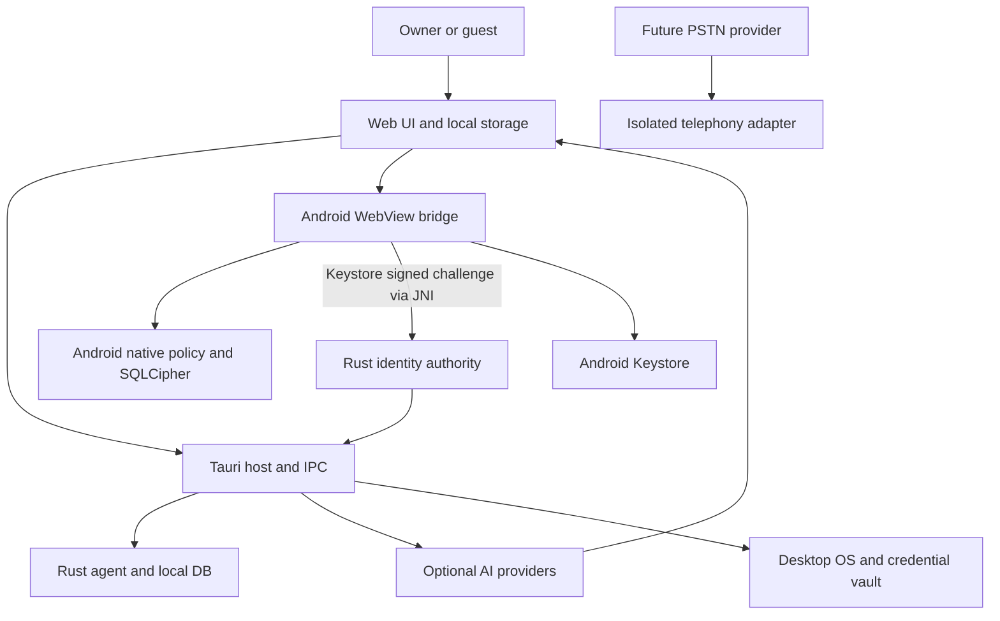

# Miss Minutes threat model

## Executive summary

Miss Minutes is a local-first React application with Tauri desktop and native Android surfaces, Rust agent/host components, local stores, and optional outbound AI-provider connections. The strongest implemented controls are narrow native bridges, encrypted native databases and vault-backed desktop secrets, typed/previewed actions, and an Android native biometric-to-Keystore signature path into the Rust authority core. Android uses the Rust session for selected settings and overlay operations and the WebView applies guest restrictions to chats, memory/context, tools, settings and personal panels. Those renderer-side restrictions do not protect IndexedDB from same-origin code; desktop has no authentication integration. The highest risks are unauthorized use of an unlocked owner device, renderer compromise exposing private data or provider credentials, private context being sent to a configured cloud model, and approval-induced execution of the desktop's arbitrary PowerShell tool.

## Scope and assumptions

- **In scope:** React/Vite web app and shared UI, Tauri desktop host and IPC, Android Java/WebView bridge and native services, existing Rust agent/identity crates, local persistence and secret storage, AI-provider/OAuth/realtime paths, model/tool execution, build/release surfaces, and planned identity/biometric/pairing boundaries described by the user.
- **Out of scope:** service-side security of AI vendors, Android/Windows/Linux OS internals, and external PSTN-provider infrastructure. PSTN is assessed only as a future, optional integration boundary that must remain separate from the trusted local core.
- **Assumed deployment:** one owner; local-first desktop and Android apps; no public application server; optional outbound calls to cloud AI providers; local biometric processing and protected credentials; trusted devices are intended to be explicitly paired; no tenants.
- Android implements deliberate first-device setup with a hardware-backed, auth-per-use Keystore P-256 key, `BiometricPrompt.CryptoObject`, and a JNI bridge into Rust. The in-memory Rust registry rehydrates from the Keystore public certificate. Selected native operations enforce the session; renderer-side restrictions for chat/settings/panels are not a security boundary against same-origin code. Android 26–27 fail closed; physical device checks remain open. Biometric matching, Windows Hello/WebAuthn, Linux FIDO2, authenticated pairing/recovery, and PSTN calling remain unimplemented.
- Existing local stores include browser IndexedDB and native SQLCipher databases. An attacker who already controls the signed-in OS account, has root/admin privileges, or runs code inside the trusted app process may be able to access plaintext while the app is active; at-rest encryption is not a defense against that attacker.
- No production release signing, update channel, deployment target for the browser build, cloud-provider data-retention terms, or PSTN vendor has been specified. These affect residual risk and need release-specific review.

**Open questions:** Will browser mode ever be served from a public origin? Which provider retention/region guarantees are acceptable for private owner context? What release signing/update trust chain will production builds use? Which telephony provider and call-consent rules would apply if PSTN is enabled?

## System model

### Primary components

- React 19/Vite web UI, chat orchestration, memory retrieval, settings, tool registry and provider adapters (`src/agent`, `src/store`, `src/services`).
- Tauri 2 desktop host with a separate avatar window, command registry/capabilities, provider proxy, OAuth callbacks, voice host and desktop tools (`native/desktop/src-tauri`).
- Rust local agent with consented filesystem metadata collection, SQLCipher evidence store, optional reasoner and typed note actions (`native/agent`).
- Android Java app with dashboard and overlay WebViews, a role-aware JSON message bridge, Java policy/approval logic, visible foreground services and a SQLCipher metadata store whose key is wrapped by Android Keystore (`native/mobile/android`).
- Rust authority core (`native/identity`): policy/session primitives and tests; Android JNI and Keystore/BiometricPrompt adapter; no desktop integration and no app-wide authorization boundary.
- Optional external AI/OAuth/realtime providers and a local Ollama endpoint. No public Miss Minutes application server or PSTN integration is present in this repository.

### Data flows and trust boundaries

- Owner/device input → React UI → browser IndexedDB or Tauri IPC: chats, memory, settings, private data and tool requests. Browser IndexedDB is origin-scoped, not encrypted by default; remembered browser API keys use WebCrypto encryption with a non-exportable key in IndexedDB (`src/store/db.ts`, `src/agent/secrets-web.ts`).
- Android WebView page → `missNative` WebMessage listener → `BridgeRouter` → native handlers: JSON requests are size-bounded, decoded against a type table, bound to a native-created page role, and limited to a fixed `https://appassets.androidplatform.net` origin/main frame; WebView file access is disabled and CSP is restrictive (`WebHost.java`, `Protocol.java`, `BridgeRouter.java`). Dashboard role is not an authenticated owner principal.
- Desktop dashboard WebView → Tauri IPC → Rust host: dashboard-window checks and Tauri capability files limit commands; the avatar capability is much narrower. Several commands return private context or provider credentials to the dashboard, which is a trusted renderer boundary (`lib.rs`, `capabilities/default.json`, `capabilities/avatar.json`).
- React/model tool call → typed tool runner → native policy or action proposal → user approval → execution: Android has an app-local `PermissionPolicy`; desktop proposals store the resolved action and approval executes the stored item. Desktop also exposes `run_command`, implemented using PowerShell, behind explicit approval (`src/agent/tools/desktop.ts`, `desktop_tools.rs`).
- Local memory/conversation/file-tool results → configured AI provider over HTTPS or WebRTC: the orchestrator includes retrieved memory and conversation in provider sessions; approved file reads and other selected context can also be sent. Provider configuration is owner-controlled, but data minimization is not enforced by the future identity core (`orchestrator.ts`, provider adapters, `provider.rs`).
- Native local stores → OS-protected keys: desktop agent DB keys and provider credentials use the OS credential vault; Android wraps the SQLCipher key with Android Keystore AES-GCM. Browser storage uses IndexedDB/WebCrypto. These controls protect copied/at-rest stores better than a live compromised process (`native/agent/src/secrets.rs`, `store.rs`, `AndroidDatabaseKey.java`, `MetadataStore.java`).
- Desktop → OAuth provider and local callback listener: OAuth uses PKCE/state/nonce and a loopback-only callback (`chatgpt.rs`, `loopback.rs`). The listener is reachable by local processes while sign-in is pending, but is not a public service.
- Android native setup/unlock → Keystore auth-per-use signature → JNI → Rust authority engine: Android checks `KeyInfo.isInsideSecureHardware`, restores a public credential from the Keystore certificate, signs one-use challenges only through `BiometricPrompt.CryptoObject`, and locks on dashboard stop/kill. Selected native operations use Rust policy; WebView guest restrictions depend on native status and cannot stop compromised same-origin code from reading IndexedDB. Desktop has no adapter. The registry/session are in-memory, and key attestation, pairing, and recovery are absent (`OwnerAuthority.java`, `jni_bridge.rs`, `lib.rs`).
- Optional future telephony provider → PSTN: no implementation exists. If added, phone numbers, called-party data, call content, credentials, billing and provider callbacks must be isolated from local identity/session authority.

#### Diagram

## Assets and security objectives

| Asset | Why it matters | Security objective (C/I/A) |
|---|---|---|
| Owner identity, device credentials and future biometric templates | Compromise permits impersonation or persistent access; biometric data cannot be rotated like a password. Templates are not implemented yet. | C/I |
| Provider API keys, OAuth tokens and realtime ephemeral tokens | Theft enables provider-account use and charges; tokens may expose account data. | C/I |
| Private memories, chats, notes, schedules, files and notifications | Sensitive personal and business information; content may be placed in model prompts. | C/I/A |
| Authority/session state and capability grants | Integrity determines whether a guest/model/plugin can perform owner actions. | I/A |
| Desktop/Android bridge commands and approval queue | Can expose local files, modify state, access camera/mic permissions or execute desktop commands. | C/I/A |
| Local databases, key envelopes, pairing/revocation records | Theft, rollback or corruption can disclose data or restore revoked trust. Pairing records are future work. | C/I/A |
| AI prompts, provider responses and tool results | Untrusted content can contain prompt injection and may be retained by a provider. | C/I |
| Release artifacts, dependencies and signing credentials | A compromised update can execute with the owner's application privileges. | I/A |
| Future PSTN account, phone numbers, call content and billing | Abuse can disclose communications or incur toll charges. | C/I/A |

## Attacker model

### Capabilities

- A person with temporary physical access to an unlocked desktop or Android device, including a guest using the visible assistant UI.
- Malicious or compromised content supplied to a model through chat, search results, documents, file reads, notifications or provider responses.
- A compromised renderer or same-origin script through a dependency, release artifact or UI injection flaw; this attacker can exercise whatever bridge/IPC surface is exposed to that renderer.
- A malicious local process able to connect to loopback during an OAuth flow, inspect user-readable files, or race local operations, but not automatically bypass OS account boundaries.
- A thief with a powered-off device or copied local files, subject to OS disk encryption, app sandboxing and the implemented DB/key protection.
- A malicious or compromised configured AI provider receiving data the app sends, or returning adversarial instructions/tool suggestions.

### Non-capabilities

- No unauthenticated public HTTP application endpoint is in the assumed deployment. The OAuth callback is loopback-only.
- A remote internet attacker cannot directly invoke Tauri/Android IPC without an additional local code-execution, renderer, provider, or social-engineering path.
- Face/voice spoofing is not currently a direct application bypass because owner face/speaker enrollment and matching are not implemented. When added, those signals must remain candidate-only.
- No multi-tenant cross-account attacker is in scope. PSTN infrastructure is not present and is assessed as a future isolated integration.

## Entry points and attack surfaces

| Surface | How reached | Trust boundary | Notes | Evidence (repo path / symbol) |
|---|---|---|---|---|
| Desktop dashboard commands | Tauri invoke from `main` window | Renderer to native Rust host | Window label checks exist on many sensitive commands; capability file grants the dashboard broad host operations. | `native/desktop/src-tauri/src/lib.rs` / `require_dashboard`, `generate_handler!`; `capabilities/default.json` |
| Desktop avatar commands | Tauri invoke from avatar window | Renderer to native Rust host | Separate capability is limited to bounds, drag and speech. | `capabilities/avatar.json` |
| Desktop credential commands | Dashboard invoke | Renderer to OS credential vault | `credential_get` returns a stored provider secret to the renderer; secret is also injected by native provider proxy. | `lib.rs` / `credential_get`; `provider.rs` / `inject_credential` |
| Desktop file/PC tools | Model tool call and approval UI | Untrusted model output to host action planner and OS | Paths are resolved/validated, previews stored, actions expire, but `run_command` executes caller-provided PowerShell after approval. | `desktop_tools.rs` / `plan`, `desktop_approve`, `run_powershell`; `src/agent/tools/desktop.ts` |
| Android dashboard/overlay WebViews | App launch and local page execution | Web content to Java native handlers | Asset loader restricts pages, origin/main frame and message schema; debug builds enable WebView debugging. | `WebHost.java` / `build`, `configure`, `onMessage`; `Protocol.java` / `decode`, `authorize` |
| Android native message types | JSON sent through `missNative` | Page role and message authority to app services | Fixed role is not owner identity; `USER_ONLY` means dashboard-originated action/direct user handling, not cryptographic re-authentication. | `BridgeRouter.java` / `dispatch`; `MessageTypes.java`; `PermissionPolicy.java` |
| Android foreground services and OS permissions | User starts overlay or metadata service; Android permission grant | App to camera/mic/overlay/storage/contacts/phone APIs | Manifest declares camera, microphone, contacts, phone-state, usage-stats and overlay permissions; biometric prompt is absent. | `AndroidManifest.xml`; `OverlayService.java`; `MetadataCompanionService.java` |
| Local database and browser storage | App runtime, device backup/copy, profile access | Application to local files/IndexedDB/Keystore | Native stores encrypt at rest; browser IndexedDB content is not generally encrypted, and a same-origin script can use WebCrypto keys. | `native/agent/src/store.rs`; `AndroidDatabaseKey.java`; `src/store/db.ts`; `src/agent/secrets-web.ts` |
| AI provider and realtime APIs | Configured provider selection, tool requests, live voice | Private local context to external provider | Host validates target host/HTTPS and body size; content itself is deliberately sent to selected provider. | `provider.rs` / `validate_target`, `run_stream`; `orchestrator.ts` / `modelTurn` |
| OAuth callback | Owner starts provider sign-in; browser redirects locally | External provider/browser to loopback listener | Uses ephemeral loopback port, PKCE/state/nonce checks, bounded request head and timeout. Local process access remains relevant. | `chatgpt.rs` / `chatgpt_sign_in`; `loopback.rs` / `bind_preferred`, `wait_for_callback` |
| Identity/biometric/pairing integration | Planned native platform adapters | Platform authenticator and device key to shared Rust policy | No Android JNI, Windows WebAuthn, biometrics, device registry or pairing implementation exists in scope today. | `native/identity/src/lib.rs`; absence of adapter modules in `native/desktop` and `native/mobile/android` |
| Build/release pipeline and dependency supply chain | CI workflows, npm/Cargo/Gradle dependencies, signing secrets | Developer/CI control to shipped binaries | Build workflows publish artifacts; release signing is optional and requires owner material. A malicious dependency/build can inherit app permissions. | `.github/workflows`; `package-lock.json`; `Cargo.lock`; `native/mobile/android/gradle/libs.versions.toml` |
| Future PSTN connector | Future provider webhook/API or call control | Telephony provider to isolated adapter | Not implemented. Provider credentials, callback authentication, caller ID and billing controls are undefined. | No PSTN adapter found in `native` or `src` |

## Top abuse paths

1. **Use an unattended owner session:** obtain physical access to an unlocked device → open the ordinary dashboard → use owner memory, settings, saved provider access or privileged UI → disclose private data or alter owner state. Android gates selected native settings/overlay operations, but desktop and most private-data/tool paths remain without owner-session enforcement.
2. **Steal provider credentials through renderer compromise:** compromise dashboard script/dependency → invoke allowed `credential_get` or inspect active in-memory browser secrets → exfiltrate API credentials → make provider calls or incur charges.
3. **Send private context to a cloud provider:** use chat with memory enabled or approve a file-read tool → orchestrator builds provider session with conversation/memory/tool results → configured vendor receives personal content and may retain it under its own terms.
4. **Prompt-injection to privileged desktop action:** attacker supplies malicious document/search result → model proposes `run_command` or destructive file operation → owner is induced to approve an unclear/benign-looking preview → PowerShell or file operation runs as the owner OS account.
5. **Exploit app-bridge authorization confusion:** compromise dashboard page or craft a message → invoke dashboard-authorized message types → rely on `Initiator.OWNER`/`USER_ONLY` being treated as owner proof despite being a UI role/source classification → reach low-risk or explicitly approved native actions.
6. **Attack stored data on a shared/unlocked browser profile:** use same-origin script execution or the already-open app profile → read IndexedDB chats/memories or decrypt remembered provider secrets via the non-exportable WebCrypto key → disclose private data. Non-exportability does not prevent use by code on the same origin.
7. **Lose/revoke a trusted device after future pairing ships:** compromise or steal a paired device → exploit weak enrollment, recovery, replay or revocation synchronization → establish or preserve owner sessions on another device. Pairing/recovery/revocation synchronization is not implemented, so no current end-to-end control is demonstrated.
8. **Abuse future PSTN credentials:** compromise a telephony adapter/provider token → place calls, impersonate the owner or obtain call content → cause financial and privacy harm. No current PSTN code or isolation boundary exists to assess.

## Threat model table

| Threat ID | Threat source | Prerequisites | Threat action | Impact | Impacted assets | Existing controls (evidence) | Gaps | Recommended mitigations | Detection ideas | Likelihood | Impact severity | Priority |
|---|---|---|---|---|---|---|---|---|---|---|---|---|
| TM-001 | Guest or other person at an unlocked device | Physical access to an unlocked owner device or an already-open browser profile. | Use owner-facing UI and commands as if the caller were the owner; retrieve memory/history or use owner controls. | Private-data disclosure and unauthorized owner actions. | Memory, chats, credentials, settings, files, sessions. | Android has a native hardware-backed biometric challenge flow into Rust and gates selected native settings/overlay handlers; Android WebView app hides owner panels and runs a guest tool/context allowlist until native session status is active; Android bridge roles remain distinct from identity; Tauri scopes commands to dashboard. | Renderer filtering is bypassable by same-origin code and does not encrypt IndexedDB; desktop has no owner authentication. Android `Initiator.OWNER` still describes direct UI input, and Tauri `require_dashboard` checks only window label. | Move private data and tool access behind native session checks, encrypt owner stores with protected keys, and integrate owner auth into Tauri commands. Require fresh OS verification for sensitive actions; test each data/tool entry point as guest. | Audit owner-session creation, lock, expiry and capability decisions; alert when private reads occur without an active session (should be impossible). | Medium: physical/unlocked access is required but shared-device or unattended use is realistic. | High: owner memory and controls are broadly sensitive. | high |
| TM-002 | Same-origin script, compromised dependency or renderer supply chain | Script execution in the dashboard WebView/browser or malicious shipped frontend. | Read private UI state, invoke privileged IPC, retrieve provider keys using the desktop getter, or misuse native capabilities. | Credential theft, data exfiltration, arbitrary owner-context actions and potentially requests to local services. | Provider credentials, local memory, tool authority, databases and local endpoints. | Android uses asset-only pages, origin/main-frame message listener, restrictive CSP and no `addJavascriptInterface`; Tauri has a CSP and separate avatar capability. | Desktop dashboard has broad Tauri capability grants; `credential_get` returns secrets; browser same-origin code can use WebCrypto to decrypt secrets; no owner session/step-up gate. Tauri's `connect-src` includes `http://localhost:*`, widening local-service reach if script execution occurs. Debug WebView has debugging enabled in debug builds. | Remove or tightly constrain renderer credential readback; keep all provider use behind native proxy; minimize Tauri permissions; restrict local CSP destinations to required services; keep production WebView debugging off; pin/review dependencies and sign/protect release pipeline; require owner re-auth for sensitive operations. | Record unusual credential reads, local endpoint requests, provider changes, command invocation rates and app build provenance; monitor dependency and signing changes. | Medium: requires renderer compromise, but frontend/dependency compromise is a plausible high-value path. | High: provider secrets and broad local commands can be reached. | high |
| TM-003 | Malicious model input, prompt injection or misunderstood provider behavior | Owner enables a cloud provider and sends chat/memory/file content, or data is supplied through a model tool. | Cause private memory, conversation, file contents or screenshots to be sent to a provider; provider processes or retains it. | Confidentiality loss outside the device; possible provider-account exposure. | Memory, conversations, files, screen captures, provider credentials. | Provider choices are explicit; native proxy restricts hosts to provider allowlists, enforces HTTPS for remote providers, caps request body, and injects secrets in headers; memory can be disabled. | Memory is added to model context by default unless disabled; no policy ties data sensitivity to provider/owner authority; approved file reads are intentionally included in model context; no app-side proof of vendor retention or redaction. | Add per-provider data scopes and clear disclosure; redact sensitive memory categories by default; require explicit consent before sending file/screen content; separate on-device/private tasks from cloud tasks; make provider retention/region settings visible. | Log provider, data categories and byte counts without content; show a local outbound-data ledger and alert on file/screen payloads. | Medium: cloud use is optional but routine and the data flow is present by design. | High: private personal/business data leaves the trust boundary. | high |
| TM-004 | Prompt injection/social engineering through AI or external content | Malicious content reaches a model while desktop tools are enabled and the owner is willing to approve. | Model proposes arbitrary PowerShell or a destructive file operation; owner approves a misleading or misunderstood preview. | User-level code execution, data loss, malware install or exfiltration. | Files, OS account, credentials accessible to user, app data. | Desktop proposal is validated and stored natively; exact stored action executes once after explicit approval; proposals expire; paths are checked; audit omits file contents/secrets. | `run_command` accepts arbitrary PowerShell and runs as the owner account. Approval UI is the primary security control; model-generated rationale is untrusted. Some repository prose describes only a create-note capability, which understates current desktop tool surface. | Remove arbitrary shell from the assistant capability set or move it behind a separate opt-in, OS-native confirmation with full command/cwd and risk explanation; prefer narrow typed operations; align architecture docs with active registry; require fresh auth for destructive/high-impact actions. | Audit full action type, normalized target, risk, approving UI event, result and parent prompt provenance; alert on shell/network/credential-sensitive commands. | Medium: direct approval is required, but prompt injection can steer the owner. | High: commands run with the owner's OS permissions. | high |
| TM-005 | Malicious local app/page or compromised Android renderer | Attacker can execute page script in the WebView, exploit an exported entry point, or send malformed bridge messages. | Abuse WebMessage bridge or confused role/message authority to reach a native handler or JNI boundary, or read browser-owned stores directly. | Unauthorized native action, private-data exposure, privacy permission use, process denial of service, or forged authority claims if native process trust is lost. | OS permissions, IndexedDB, native DB, approval queue, authority sessions and app availability. | Fixed origin/main-frame listener, native page role, bounded message protocol and no `addJavascriptInterface`; owner authentication methods exist only in native Java/JNI and are not registered as WebView message types. Selected settings/overlay handlers authorize through Rust; chat UI applies a guest allowlist. | Dashboard role and renderer guest flag are not owner proof; IndexedDB remains origin-readable; JNI trust assumes the signed app process and Java adapter are intact; Android permissions are broad. | Put private data behind native session checks and protected storage; keep JNI methods off renderer IPC; reduce Android permissions to just-in-time use; fuzz protocol and native boundary payloads; test lifecycle and prompt races. | Log denied message types, auth failures, permission starts/stops and handler exceptions without sensitive payloads; rate-limit expensive handler families. | Low to medium: origin controls are strong, but renderer/process compromise is plausible. | High: native handlers run with app-granted privileges. | medium |
| TM-006 | Thief or malware with access to copied device files or live app process | Device loss, backup/profile access, local malware, root/admin, or same-origin execution. | Copy DB/key envelopes, query browser IndexedDB, inspect active process memory, or restore stale owner data. | Data disclosure, rollback, or reuse of credentials/session material. | Local DB, chats, memories, provider secrets, revocation state. | Desktop SQLCipher key in OS vault; Android SQLCipher key wrapped by non-exportable Keystore key; Android backup disabled and missing-key paths fail closed; desktop vault-backed credentials. | Browser chats/memories are in IndexedDB without general encryption; desktop provider getter exposes keys to renderer; no owner-session invalidation or cross-device revocation/pairing exists. OS-level compromise can observe plaintext after unlock. | Encrypt browser private data with protected keys where supported and document same-origin limits; ensure backup excludes device-bound keys/envelopes; build remote revocation only after authenticated pairing; provide device-loss recovery and session invalidation; minimize secrets in renderer memory. | Detect missing/replaced key envelopes and DB rollback where feasible; record device revoke events; audit vault read failures and credential access. | Medium: local malware/device loss is less common than app use but credible. | High: copied or live data includes sensitive personal information. | medium |
| TM-007 | Malicious or compromised future pairing/recovery flow | Device pairing, recovery credentials or cross-device session sync is implemented. | Replay pairing challenges, substitute a public key, abuse recovery, or delay revocation propagation. | Persistent owner impersonation across devices. | Owner identity, trusted-device registry, private memory and all owner capabilities. | Rust core now has a one-use, expiring challenge and P-256 signature verification for an enrolled public key; intended pairing is from a trusted device or recovery credential. No pairing implementation is present. | No persistent key registry, platform key enrollment/attestation, recovery model, cross-device revocation protocol, or pairing tests exist. The core's registry is in-memory. | Design protocol before enabling pairing: signed nonce challenges, key confirmation, user-visible device fingerprints, strict expiry, revocation tombstones, recovery rate limits, and independent hardware-backed keys; add replay/key-substitution tests. | Append-only device enrollment/revoke log and notifications on new device enrollment; alert on stale revocation epochs. | Low today because the flow is absent; medium once shipped without protocol controls. | High: pairing silently creates owner-equivalent authority. | medium |
| TM-008 | Malicious/deceptive PSTN caller or compromised telephony provider | A future PSTN integration is added with provider credentials, webhooks or call control. | Forge callbacks, abuse call initiation, steal phone/call metadata, or run up charges. | Fraud, impersonation, communications disclosure and financial harm. | Phone numbers, call audio/transcripts, provider credentials and billing. | No current PSTN integration; user's baseline requires it to be optional and separately isolated. | Provider, callback authentication, consent, recording policy, rate limits and financial caps are unspecified. | Keep telephony in a separate adapter/process and capability namespace; authenticate signed callbacks; require explicit consent and fresh auth for outbound calls; cap rate/spend; never give provider credentials to the model. | Provider-side spend alerts, per-number rate limits, signed callback verification logs, and call-consent audit trail. | Low until implemented. | High: communications and billing are sensitive. | low |
| TM-009 | Dependency, build or release compromise | Attacker compromises npm/Cargo/Gradle dependency, CI token, signing key or release artifact. | Ship a modified UI/native binary that reads private data or invokes native capabilities. | Broad persistent compromise of owner devices and credentials. | All local data, provider credentials, signing trust and app integrity. | Lockfiles pin dependency resolution; CI builds and publishes artifacts; signing is optional and owner-held signing material is not committed (per roadmap). | No reviewed signed-update trust chain or runtime code-signing enforcement is established by this subsystem; unsigned artifacts may be distributed. An attacker-controlled build has app authority. | Require signed releases with protected keys, provenance/attestation verification, dependency review and reproducible build checks where practical; protect CI permissions and release approvals; document unsigned builds as development-only. | Artifact hashes, provenance verification, dependency alerting, CI permission/change logs, and release signature monitoring. | Low to medium: requires supply-chain/CI compromise but payoff is high. | High: malicious release obtains the app's local authority. | high |

## Criticality calibration

- **Critical:** a remote unauthenticated path to owner-level code execution or mass exfiltration without physical access/consent. No such public server is in the assumed architecture; a future public telephony or relay endpoint would need reassessment.
- **High:** owner-level command execution, broad private-data disclosure, or provider credential theft after a plausible local/renderer compromise; examples are un-gated owner UI on an unlocked shared device, renderer access to provider credentials, and command approval induced through malicious model context.
- **Medium:** bounded or interaction-dependent unauthorized actions, local store exposure requiring device/profile access, or future pairing/revocation weaknesses before the feature is enabled.
- **Low:** impacts limited to availability, harmless guest functions, or an unimplemented integration with no current execution path; examples are a malformed Android bridge message rejected by protocol checks, a provider timeout, or future PSTN risk before telephony exists.

## Focus paths for security review

| Path | Why it matters | Related Threat IDs |
|---|---|---|
| `native/identity/src/lib.rs` | New policy core is not integrated and trusts the caller of authentication completion. | TM-001, TM-005, TM-007 |
| `native/identity/src/jni_bridge.rs` and Android `OwnerAuthority.java` | JNI signatures, native-only challenge flow, Keystore assurance and process/lifecycle trust boundary. | TM-001, TM-005, TM-006 |
| `native/desktop/src-tauri/src/lib.rs` | Tauri command entrypoints, dashboard checks, credential getter and owner-context handlers. | TM-001, TM-002 |
| `native/desktop/src-tauri/capabilities/default.json` | Defines wide dashboard command permissions; compare carefully with command-level checks. | TM-001, TM-002 |
| `native/desktop/src-tauri/capabilities/avatar.json` | Verifies the avatar stays out of the dashboard authority boundary. | TM-002 |
| `native/desktop/src-tauri/src/desktop_tools.rs` | Path resolution, file actions, approval queue and PowerShell execution. | TM-004 |
| `src/agent/tools/desktop.ts` | Model-visible tools and risk/confirmation classifications. | TM-004 |
| `src/agent/brain/orchestrator.ts` | Builds provider sessions with conversation and retrieved memory; executes model tool loops. | TM-003, TM-004 |
| `src/agent/memory/recall.ts` | Determines which private memories enter model context. | TM-003 |
| `native/desktop/src-tauri/src/provider.rs` | Provider allowlist, credential injection, request body and realtime-token paths. | TM-002, TM-003 |
| `native/desktop/src-tauri/src/chatgpt.rs` | OAuth state, PKCE, token persistence and local callback flow. | TM-002, TM-009 |
| `native/desktop/src-tauri/src/loopback.rs` | Loopback listener request parsing and callback bounds. | TM-002 |
| `native/mobile/android/app/src/main/java/com/patel5600/missminute/mobile/bridge/WebHost.java` | WebView origin, CSP, navigation and native listener boundary. | TM-005 |
| `native/mobile/android/app/src/main/java/com/patel5600/missminute/mobile/core/protocol/Protocol.java` | Message parsing, type validation, payload and role authorization. | TM-005 |
| `native/mobile/android/app/src/main/java/com/patel5600/missminute/mobile/core/policy/PermissionPolicy.java` | Current Android policy distinguishes initiator/mode, not authenticated owner identity. | TM-001, TM-005 |
| `native/mobile/android/app/src/main/java/com/patel5600/missminute/mobile/AndroidDatabaseKey.java` | Keystore wrapping, failure behavior and data-at-rest assumptions. | TM-006 |
| `native/agent/src/secrets.rs` and `native/agent/src/store.rs` | OS-vault keys, SQLCipher initialization/migration, owner context and action queue. | TM-006 |
| `.github/workflows` | Build artifact and release supply-chain permissions/provenance. | TM-009 |

## Notes on use

This is a repository-grounded design threat model, not a penetration test, cryptographic review, platform security audit, or certification. Android's credential path has only been source/build validated; no physical device was attached. Session checks are not wired into WebView data and most tools; desktop authentication, biometric matching, pairing/recovery and PSTN are not implemented. Before production owner-authority claims, integrate the native session check into every data/tool entry point and validate on physical Android and desktop devices.
